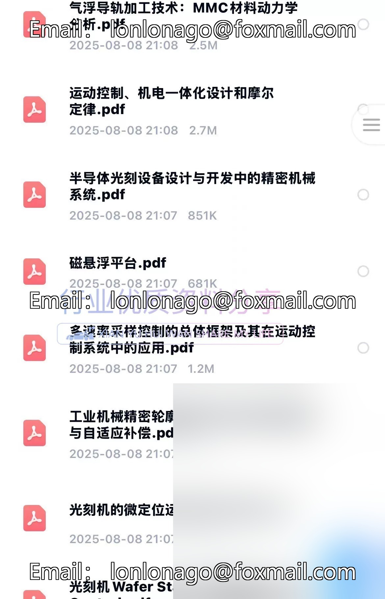
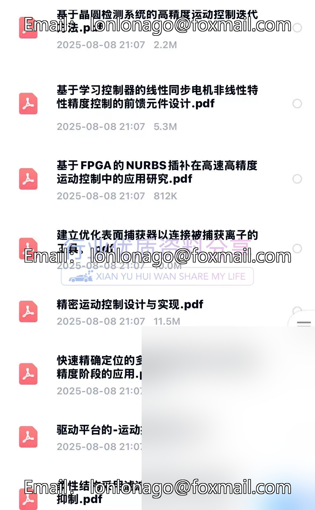

# Magnetic levitation wafer motion table related technical materials, lithography machine motion table materials, about 100.

## Body

Technical data related to magnetic levitation wafer motion table, data of light etching machine motion table, approximately 100 technical data sets!

Capture and send the electronic original directly! The following images include screenshots of the file portion. Please confirm before placing the order! Due to the replicable nature of electronic documentation Therefore, are allowed after purchase! Thanks for understanding!

For personal learning and reference use only.

The materials cover magnetic levitation wafer motion platforms, lithography machine motion platforms, and include floating guides, MMC material dynamics, semiconductor lithography equipment design, motion control, and electromechanical integration topics.

<!-- AI_ENRICHED -->

## Images

## Payment

Here is a pay link on Stripe ( https://buy.stripe.com/3cs8yP7sY87d0vu9AB ). Please contact me lonlonago@foxmail.com after funding $89, and I will send you a complete data files , thank you!

